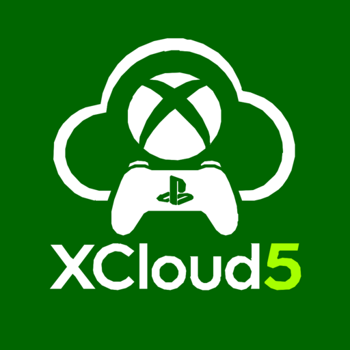

# XCloud5

**Xbox Cloud Gaming on PlayStation 4 — an independent, open-source homebrew client.**

XCloud5 brings an Xbox-style cloud gaming experience to a **PS4 running GoldHEN**, without pretending to be an official Xbox or PlayStation application. The project builds with the open-source OpenOrbis PS4 Toolchain.

**Latest package:** [XCloud5 v1.3.3 — Russian UI & Update Fix](https://github.com/Neyvoris/XCloud5/releases/tag/v1.3.3) · [Download the PS4 installer](https://github.com/Neyvoris/XCloud5/releases/download/v1.3.3/XCloud5-1.3.3-PS4.pkg)

> **Independent software.** Not affiliated with, sponsored by, or endorsed by Microsoft, Xbox, Sony, or PlayStation. Xbox Cloud Gaming access, titles, subscriptions, and regions are governed by Microsoft's terms. This software is provided without warranty.

## What's new

### v1.3.3 — Russian UI and update source fix (24 November 2026)

- Fixed public update checks and GitHub release asset downloads to use **Neyvoris/XCloud5**, not the unrelated upstream XCloud4 release.
- Added **Русский** to the Settings → Interface → Language menu, with persistence and Russian PS4 system-language autodetection (PS4 language ID 8).
- Added complete Russian translations covering UI strings and Xbox/HTTPS session status messages. The six existing languages remain available.
- Extended the Noto Sans and Inter PS4 font atlases with actual Cyrillic glyphs; verified coverage and the 4 MiB runtime font budget.
- Corrected the public About screen project owner, repository URL and XCloud5 identity.
- Public PS4 metadata version **01.50** retains Title ID `XCLD00003`.

**Updater security:** The built-in automatic installer requires a separately signed update manifest and signature. Releases with only a PKG and SHA-256 text file must use the manual GoldHEN installation method; verification is not silently bypassed. The update prompt and release URL now identify the correct repository. Real-hardware testing is still required.

In the public build, XCloud5 starts a signed update while idle at the home screen, downloads and verifies the package, then queues installation through the PS4 BGFT service. It does not start while a game session, authentication flow, or launch is active. Once PS4 accepts the package, XCloud5 closes so the system can finish installing it. If BGFT cannot accept the package, XCloud5 keeps the verified PKG in `/data/pkg` for manual installation.

### v1.3.2 — New PlayStation 4 icon (23 November 2026)

- Added the approved **Xbox-green XCloud5 app icon** with a white cloud, Xbox emblem, minimal PS4 controller silhouette, and XCloud5 wordmark.
- Clean, uniform white and green fills replace the old art, with no gradient artifacts or decorative frame.
- Public PS4 icon is a **512 × 512 PNG**; the experimental Lab edition retains its separate icon.
- Updated package to **1.3.2 / APP_VER 01.49**, preserving Title ID `XCLD00003` so it can upgrade the existing public installation.
- Previous **1.3.1 Microsoft sign-in timeout fix** and Xbox Home improvements are retained.

**This is a branding and documentation release, not a new authentication or streaming overhaul.**

### v1.3.1 — Sign-in bug fix (23 November 2026)

- Improved **Microsoft sign-in reliability** for the "Could not complete sign-in" / **`0x8041013c · HTTP 0`** error that can occur while opening an HTTPS connection.
- Increased the **TCP connection phase timeout** for selected Microsoft authentication endpoints from **5 to 12 seconds**.
- Kept the overall **30-second request deadline**, cancellation polling, TLS certificate verification, and hostname checks unchanged.
- Added regression checks for default versus Microsoft-specific deadlines, caller overrides, and the absolute request cap.
- Rebranded the **public PS4 package to XCloud5**, with product version **1.3.1**, PS4 package version **01.48**, and the unchanged public Title ID `XCLD00003`.
- Built the release with a GitHub Actions pipeline that verifies the OpenOrbis SDK download hash, compiles pinned dependencies, audits the executable, packages the PS4 application, validates package metadata, and uploads the installer and its checksum.

**Verification:** [the successful GitHub Actions build](https://github.com/Neyvoris/XCloud5/actions/runs/45262215890) passed compilation, native streaming gates, package verification, and release upload. **A successful build is not proof that sign-in or gameplay works on every PS4.** The original timeout case still needs real-console confirmation. Other errors caused by blocked networks, DNS, routing, or service outages may remain.

Changes: [sign-in fix PR #1](https://github.com/Neyvoris/XCloud5/pull/1), [packaging/build PR #2](https://github.com/Neyvoris/XCloud5/pull/2).

### Xbox Home interface and usability work

The project also includes the Xbox Home-inspired redesign and navigation improvements developed in the `xbox-home-motion` work:

- Home, Discover, Catalog, My Games, Search, Account, and Settings with richer game artwork.
- Transitions and animated selection/focus states, including the in-game touchpad overlay.
- Expanded **L1/R1** navigation between sections and tabs.
- Search/catalog presentation and artwork-loading improvements.
- Game details, screenshots, related games, filters, favorites, and store QR links where available.
- Better protection against accidentally losing unsaved settings changes.

The public edition continues to include the established controller, streaming, networking, audio, and update functionality documented below. **Availability depends on the cloud service and the connected console; individual features have not all been independently validated on hardware in this fork.**

## Features

| Area | Functionality |
| --- | --- |
| Xbox-style interface | Home, Discover, Catalog, My Games, Search, game-detail pages, Account, and Settings |
| Discovery | Search; genre, access, favorites and multiplayer filters; curated categories and featured rows |
| Personal library | Recent titles, favorites, game details, and PS4-local play-history data |
| Languages | Russian, Spanish, English, Brazilian Portuguese, French, Italian, and German; system-language detection and manual selection |
| Controllers | Up to four local DualShock 4 controllers associated with separate PS4 user profiles, for compatible games |
| In-game overlay | Hold **two fingers on the touchpad for 1 second** to open the in-game menu |
| Streaming options | Stream reload and reconnection logic, quality options including 1080p Max (where supported), and optional network statistics |
| Audio and picture | Optional supported headset microphone, GPU-assisted color conversion, and default VSync |
| Account | Microsoft device-code sign-in using an external phone/PC; optional remember-me mode |
| Network security | Integrated HTTPS/TLS with certificate/hostname validation |
| Updates | Release checks and verified package downloads, with a guided GoldHEN installation flow |
| Lab edition | Separate experimental build with Lua controller scripting, telemetry, and diagnostics; not the recommended public package |

## Requirements

- **PlayStation 4 with GoldHEN** and the ability to install homebrew packages. This is **not** a PS5 or an official PlayStation Store app.
- A Microsoft account with an Xbox profile. Cloud-playable subscription games normally require an eligible Game Pass plan; free-to-play games such as Fortnite may have different account requirements. Eligibility and regional availability can change.
- A stable network connection. **15 Mbps or better** is a useful starting point; Ethernet is recommended.
- An external phone, tablet, or PC for Microsoft's device-code sign-in.

The upstream project reports testing on a PS4 Fat with firmware 12.00 and GoldHEN v2.4b18.7. **This fork's v1.3.1 bug fix has not yet been independently verified on a physical PS4.**

## Download and install

1. Open the [latest release](https://github.com/Neyvoris/XCloud5/releases/latest).
2. Download **`XCloud5-1.3.3-PS4.pkg`** from **Assets**, along with **`SHA256SUMS.txt`** if you want to verify the file. The GitHub-generated *Source code (zip)* and *Source code (tar.gz)* are **not** PS4 installers.
3. Transfer the `.pkg` to a USB drive formatted as FAT32/exFAT, or copy it to `/data/pkg/` using GoldHEN FTP.
4. Install it using **GoldHEN → Package Installer** (or the corresponding Debug Settings package installer).
5. Launch **XCloud5**, select **Sign in**, and follow the Microsoft device-code instructions on your phone/PC. Enter credentials **only** on Microsoft's official sign-in site.

**Upgrade compatibility:** The public package keeps **Title ID `XCLD00003`** and Content ID `IV0000-XCLD00003_00-XCLOUD4PUBLIC000`. Its PS4 metadata version is **01.50**. The legacy Content ID is deliberately unchanged for update compatibility and is not evidence of an old binary.

**Checksum:** compare the SHA-256 of your download with the `SHA256SUMS.txt` asset from the same release. Never rename an older package to imitate a new version.

### In-app updates

The client checks GitHub Releases for updates and includes a path to download and verify supported update packages to `/data/pkg`. Depending on the environment, you may still need to close the application and install the downloaded file manually from GoldHEN's Package Installer. Automatic installation is not guaranteed on every console.

## PS4 controls

| Controller input | Action |
| --- | --- |
| D-pad / left stick | Navigate cards and menus |
| **✕ (Cross)** | Select / confirm / launch |
| **○ (Circle)** | Back / close |
| **L1 / R1** | Switch sections and tabs |
| **OPTIONS** (outside gameplay) | Open quick settings |
| **Two fingers on touchpad for 1 second** (during a game) | Open the in-game overlay |
| D-pad / left stick (in overlay) | Choose Return to catalog, Reload stream, microphone mute, Xbox button, or Cancel |
| Touchpad click (during gameplay) | Xbox View button |
| **OPTIONS** (during gameplay) | Xbox Menu/Start button |
| PS button → Close Application | Close XCloud5 |

Some mappings depend on the game and on which context is currently active.

## Language and region

The public v1.3.3 package provides seven interface languages: **Русский, Español, English, Português (Brasil), Français, Italiano, Deutsch**. Select a language in **Settings → Interface → Language**, or choose **Automatic** to use a supported PS4 system language with English fallback.

Store locale and market settings are separate from the interface language. Changing UI language does **not** grant access to different cloud games or change account eligibility.

**Russian (`Русский`) is selectable in Settings → Interface → Language**, and selected automatically when the PS4 system language is Russian. All previous language choices remain supported.

## Troubleshooting

### Could not complete sign-in · `0x8041013c` · `HTTP 0`

This points to a **TCP/HTTPS connection timeout before an OAuth HTTP response**; it is **not** itself evidence that Microsoft rejected your password. Version 1.3.1 allows more time for Microsoft authentication connections. If the error persists:

1. Verify the PS4 can access the internet and check the console date/time.
2. Restart the application and, if useful, test an Ethernet connection.
3. Check DNS resolution and router/firewall restrictions; optionally test reliable public DNS servers such as `1.1.1.1` or `8.8.8.8`.
4. Try the same network with another device and check Xbox service availability.
5. Report the exact error code, stage, firmware, GoldHEN version, and XCloud5 version in a [GitHub issue](https://github.com/Neyvoris/XCloud5/issues), **without posting passwords, device codes, tokens, or sensitive log details**.

### Other common problems

| Symptom | Possible next step |
| --- | --- |
| No Xbox profile | Sign in at [xbox.com](https://www.xbox.com) and finish creating your Xbox profile |
| DNS error `0x804101DC–0x804101EF`, `0x80410140`, or `0x80410141` | Check PS4 network and DNS settings |
| No game video | Retry the title or switch servers if the Settings UI allows it; record diagnostic details |
| Xbox queue / busy servers | Wait, cancel, or retry when service capacity improves |
| Region / access error | Verify the account and title are supported in your region using [Xbox regional information](https://www.xbox.com/regions) |
| Game missing from catalog | Check account entitlement, official Xbox availability, filters, and the selected catalog region |

The optional **Access country** setting concerns a cloud request header; it does not buy or unlock a subscription, modify your Microsoft account country, or bypass Xbox eligibility rules. Using a different access country can conflict with Microsoft's terms. HTTP 403 can have several causes.

### Privacy and sign-in

- XCloud5 uses Microsoft's device authorization flow. Enter your password on the Microsoft website, not into a third-party console form.
- The application uses a **public OAuth client ID**, which is not a secret.
- The optional **Remember me** feature stores a session locally on the console; logging out clears saved sign-in state according to the client implementation.
- Downloading a public release does **not** grant the downloader access to the maintainer's account.
- **No automatic GitHub Issues diagnostics upload** is included. Users decide what information to share.
- Do not publish Xbox tokens, authorization headers, device codes, passwords, or identifying console logs.

## Build from source

See **[BUILDING.md](BUILDING.md)** for Linux/OpenOrbis prerequisites, dependency versions, the public and Lab build modes, and packaging details.

The public v1.3.3 source uses:

- OpenOrbis PS4 Toolchain **v0.5.4**, with the upstream SDK archive SHA-256 checked by CI.
- Pinned **libdatachannel 0.24.6**, **libjuice 1.7.4**, usrsctp, libsrtp, **Mbed TLS 3.6.7**, and **Opus 1.5.2**.
- PS4 `libSceFios2.prx` and `libc.prx` SELF runtime modules.
- `X4_PUBLIC=1` for the downloadable public edition; `X4_PUBLIC=0` for experimental Lab.
- Version `1.3.3` / PS4 `APP_VER=01.50` / `XCLD00003`.

### Automated build and tests

The [v1.3.3 workflow](.github/workflows/build-v1.3.3.yml) runs on Ubuntu, installs host tools, verifies the SDK, builds pinned libraries, compiles the PS4 executable, runs native import/stack gates, produces the PKG, verifies package identity, and creates SHA-256 output. The [v1.3.1 release build](https://github.com/Neyvoris/XCloud5/actions/runs/45262215890) completed successfully and uploaded its installer. The v1.3.2 workflow follows the same checks and packages the approved icon.

Additional **host tests** live under `tests/` and `scripts/test_*.sh`, covering areas such as languages, settings persistence, catalog and artwork caching, HTTP/TLS, authentication, controller navigation, image/audio/video processing, stream recovery, and package identity. These tests are not equivalent to testing Xbox Cloud Gaming end-to-end on a physical PS4.

**Known verification boundary:** the repository also includes older documentation in `src/streaming/README.md` describing an earlier 0.6.2 streaming state. It is historical and should not be treated as a verified statement about every feature in v1.3.1. Real-console gameplay, sign-in, and device compatibility still need independent confirmation.

## Project structure

- `src/core/`: application lifecycle, identity, orchestration.
- `src/ui/`: UI, language tables, navigation, catalog/game pages.
- `src/auth/`: Microsoft/Xbox authentication, HTTPS, sessions.
- `src/streaming/`, `src/video/`, `src/audio/`, `src/media/`: streaming and media pipelines.
- `src/input/`: controller handling.
- `src/update/`: release checks and package updates.
- `assets/`: application icon, backgrounds, fonts, resource files.
- `scripts/`: build, packaging, audits, diagnostics, test runners.
- `tests/`: native and portable test fixtures.

## License, attribution, and contribution

XCloud5 is distributed under **GNU GPL-3.0-only**. See [LICENSE](LICENSE), [THIRD_PARTY_NOTICES.md](THIRD_PARTY_NOTICES.md), and [docs/licenses](docs/licenses). XCloud5 includes earlier GPL-licensed components and later independent changes to UI, navigation, networking, packaging, and artwork. Specific source provenance and historical contributions are documented in [SOURCE_PROVENANCE.md](SOURCE_PROVENANCE.md); applicable notices are retained.

Issues and constructive contributions are welcome. Before posting debug logs or screenshots, remove account identifiers and secrets.

This project is **not** an official Microsoft, Xbox, or Sony product and provides no cloud access, licenses, or subscriptions by itself.
